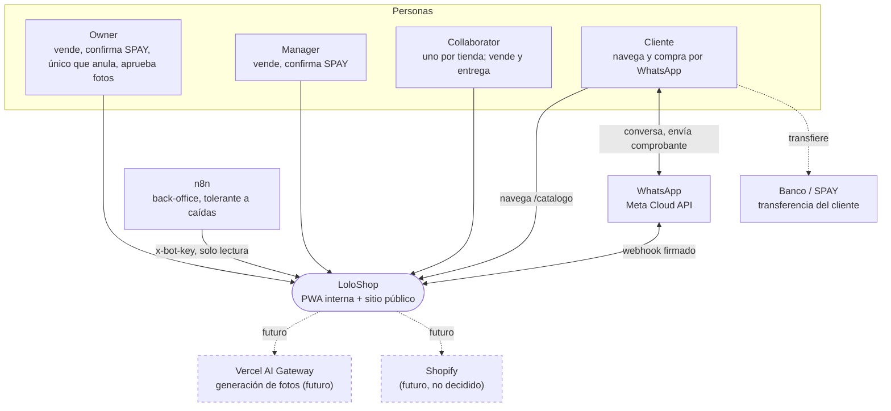
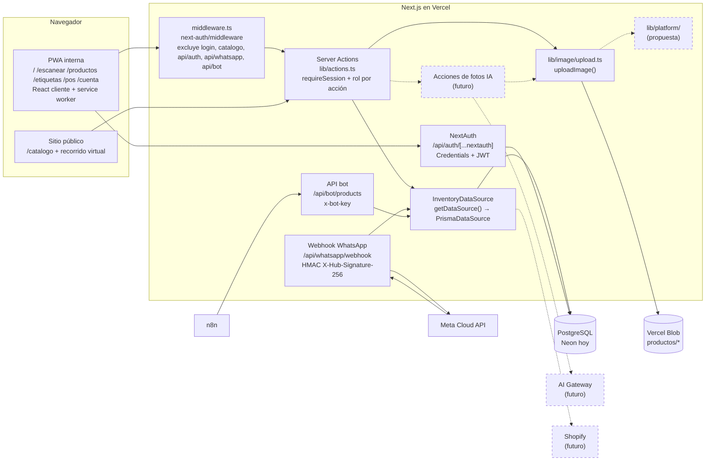
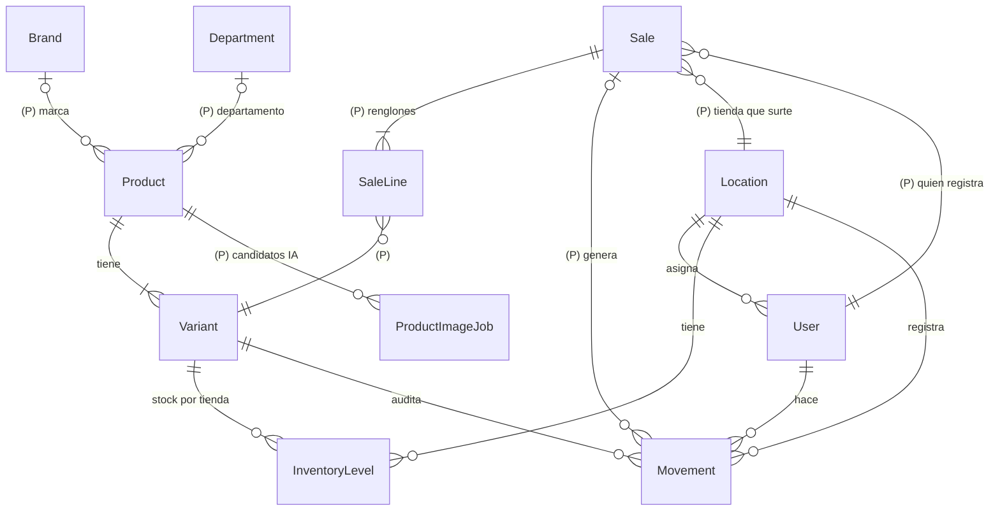
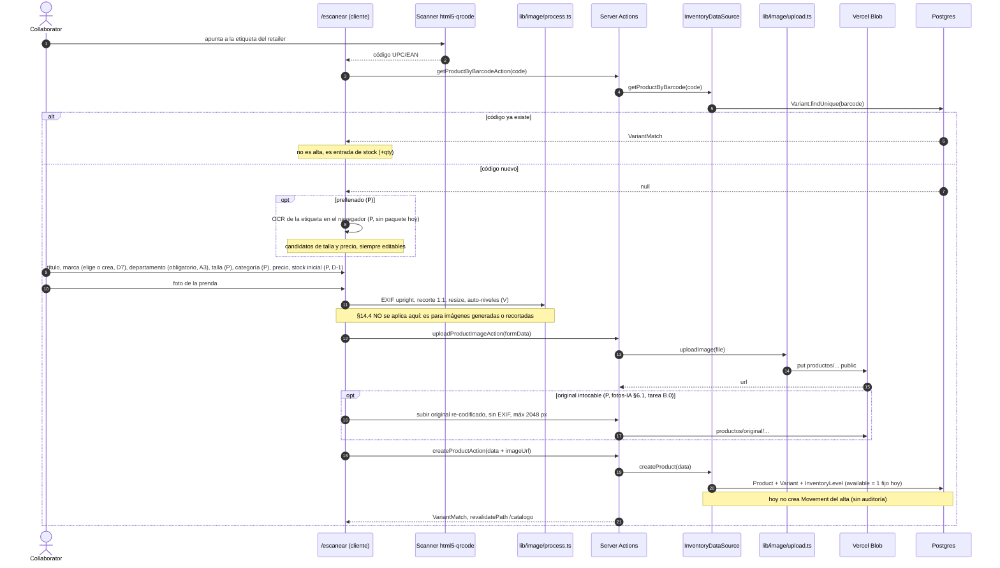
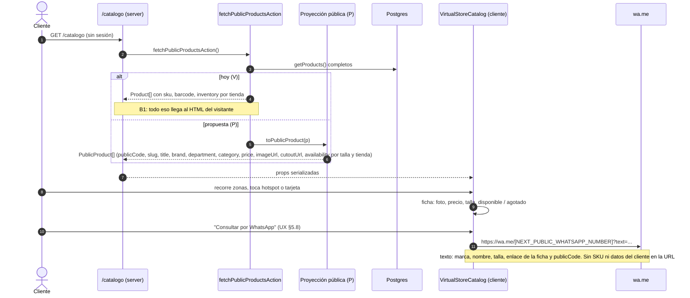
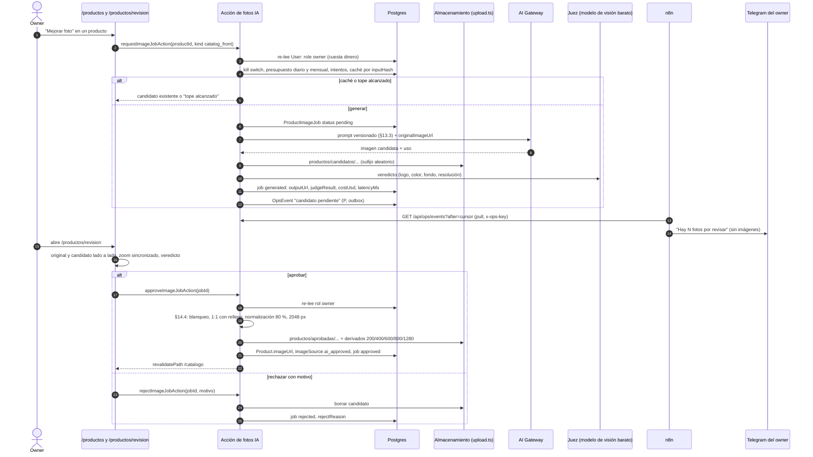
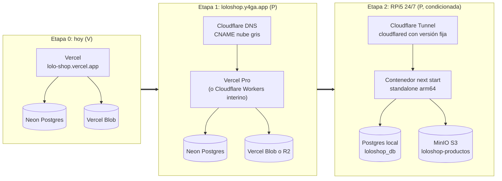
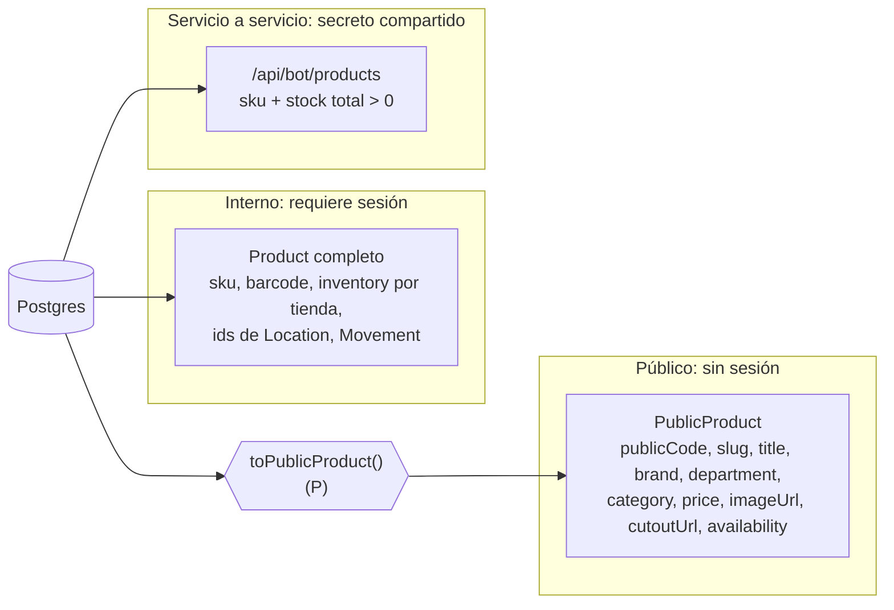

# LoloShop: arquitectura y flujos

- **Fecha:** 2026-11-05 · **Autor:** `architect` · **Estado:** referencia para portafolio y para planificar la implementación.
- **Repo público:** este documento solo nombra variables de entorno. Ningún valor.
- **Base verificada:** `main` @ `bed06d2` más el árbol de trabajo sin commitear del 2026-11-05 (incluye `app/catalogo/*`, `lib/virtual-store/`, `components/virtual-store/`).
- **Actualización 2026-11-05 (tarde):** alineado con las decisiones D1 a D7 y A1 a A7 (registro en §6). El modelo de datos canónico es `2026-11-05-modelo-datos-er.md` (**ER**); el SRS es `2026-11-05-loloshop-srs.md`.
- **Convención:**
  - **[V]** verificado leyendo el código o la configuración en esa base.
  - **[P]** propuesta: no existe en el código. Los nombres comunes (`Sale`, `SaleChannel`, `PaymentMethod`, `Brand`, `Department`, `ProductImageJob`) son propuestas compartidas con los otros agentes.
  - **[D]** decisión del dueño (las del 2026-11-05 llevan su número D1…D7).
  - **[A]** decisión del autor, revisable por el dueño (A1…A7).
  - **[NV]** no verificado: confirmar antes de actuar.

Documentos relacionados: spec maestro (`2026-10-27-loloshop-maestro-design.md`), fotos con IA (`2026-10-19-fotos-producto-ia-design.md` §6, §7, §13, §14), dominio (`2026-10-19-loloshop-dominio-y4ga-design.md`), n8n (`2026-10-19-n8n-flujos-design.md`), bot de WhatsApp (`2026-06-28-loloshop-whatsapp-bot-design.md`).

---

## 0. Resumen

LoloShop es una PWA de inventario y catálogo para dos tiendas físicas de ropa y accesorios. El personal (`owner`, `manager`, `collaborator`) da de alta prendas escaneando su etiqueta, les toma foto y registra entradas y salidas. El cliente ve un catálogo público y compra por WhatsApp. No hay carrito ni cobro en línea.

| Pieza | Hoy | Siguiente |
|---|---|---|
| Framework | Next.js 14.2 App Router, React 18, `next-pwa` [V] | Next 15.5, React 19, Serwist (PR #17, rama `feat/next-15`) [V] |
| Datos | Prisma 5.22 sobre PostgreSQL (Neon), detrás de `InventoryDataSource` [V] | Baseline de `prisma migrate` (no existe `prisma/migrations/`) [V] |
| Auth | `next-auth` 4, solo credenciales, sesión JWT, bcrypt [V] | Sin cambios |
| Imágenes | Canvas en cliente (`lib/image/process.ts`), subida en servidor (`lib/image/upload.ts` con `@vercel/blob`) [V] | Original guardado, estándar §14, interfaz de almacenamiento [P] |
| Canal de venta | Tienda física y WhatsApp. No existe modelo de venta: una venta hoy es un `Movement` con delta negativo [V] | `Sale` con `SaleChannel` y `PaymentMethod` [P] |
| Hosting | Vercel, `lolo-shop.vercel.app` [V] | `loloshop.y4ga.app` → (condicionado) RPi5 24/7 |

---

## 1. Contexto y contenedores

### 1.1 C4 nivel 1: contexto



Notas:
- SPAY no tiene integración: LoloShop **no** habla con el banco. El pago se confirma a mano con el comprobante [V: no hay código de pagos].
- El bot de 2026-06-28 preveía Mercado Pago vía n8n. No está implementado [V].
- Shopify aparece en specs antiguos como fuente futura detrás de `InventoryDataSource`. Hoy no hay `ShopifyDataSource` [V] ni decisión de integrarlo [D pendiente].

### 1.2 C4 nivel 2: contenedores



| Contenedor | Estado | Archivo |
|---|---|---|
| PWA interna | [V] `/` dashboard, `/escanear`, `/productos`, `/etiquetas`, `/cuenta`. `/pos` es una maqueta visual: no llama a ninguna acción de escritura | `app/*/page.tsx` |
| Sitio público | [V] `/catalogo` (fuera del middleware). Renderiza `VirtualStoreCatalog` | `app/catalogo/page.tsx` |
| Server Actions | [V] 11 acciones, todas con `requireSession()` salvo `fetchPublicProductsAction` | `lib/actions.ts` |
| NextAuth | [V] JWT con `id`, `role`, `locationId` copiados al iniciar sesión | `lib/auth/options.ts` |
| Webhook WhatsApp | [V] menú por palabras clave, consulta stock por SKU | `app/api/whatsapp/webhook/route.ts` |
| API bot | [V] lista productos con SKU y stock total > 0 | `app/api/bot/products/route.ts` |
| Data source | [V] interfaz con 8 métodos, una implementación Prisma y una de fixtures | `lib/data/source.ts`, `prisma-source.ts`, `fixture-source.ts` |
| Subida de imágenes | [V] `put()` de `@vercel/blob`, `access: "public"` | `lib/image/upload.ts` |
| `lib/platform/` | [P] no existe en `main`. Existe solo en el spike de Cloudflare | — |
| AI Gateway | [P] el paquete `ai` no está instalado [V] | — |

### 1.3 Modelo de datos



**Verificado [V]** (`prisma/schema.prisma`): `User`, `Location`, `Product` (`brand` y `category` son texto libre), `Variant` (`sku` y `barcode` únicos, `size` por defecto `"U"`, `color` por defecto `"General"`, `price` decimal), `InventoryLevel` (`@@unique([variantId, locationId])`), `Movement` (con enum `MovementType` = `SALE | RESTOCK | ADJUSTMENT | TRANSFER | DAMAGE`). **Ninguna escritura usa `type`**: todo movimiento queda como `ADJUSTMENT`.

**Propuesto [P]:** la definición canónica de entidades, campos, enums e índices está en **`2026-11-05-modelo-datos-er.md`** (fuente de verdad del modelo; este documento no la repite). En resumen: `Sale` + `SaleLine`, `SaleStatus` = `pending_payment | paid | cancelled | refunded` (sin otros estados), con el descuento de stock separado del pago (`stockCommittedAt`), `clientRequestId` para idempotencia; `Brand` y `Department` como tablas (Department editable, D6); `Product.publicCode` (A6); `AppSetting` para el umbral de stock bajo (A5); `Movement.saleId` y `type = SALE`. Todo vía `prisma migrate` tras el baseline (B5).

Reglas del modelo propuesto:
- `Sale` **no guarda datos de contacto del cliente** [D] D5 (LFPDPPP; el chat vive en WhatsApp). Solo `customerAlias`, un alias corto opcional escrito por el personal, sin teléfono.
- `Brand` y `Department` se rellenan desde los textos actuales con un script `tsx` tras la migración aditiva, no con SQL a mano (ER §5.2).

---

## 2. Flujos

### 2.1 (a) Alta de producto por escaneo de la etiqueta del retailer

Contexto verificado [V]:
- El escáner es `html5-qrcode` (`components/inventory/Scanner.tsx`). Lee el código de barras (UPC/EAN) de la etiqueta del retailer.
- Si el código no existe, `/escanear` abre `NewProductForm`. El formulario pide título, marca, precio y foto. **No pide talla, color, categoría ni stock**: `createProduct` crea una sola variante con `size = "U"`, `category = "General"` y `available = 1` fijo.
- **OCR: no hay ningún paquete instalado** (`package.json` sin `tesseract.js` ni similares; `node_modules` sin coincidencias) [V]. Tampoco aparece en ningún spec del repo [V].
- Un UPC/EAN de retailer **no codifica talla ni precio**. El prellenado solo puede venir de: un código ya conocido en la BD, una consulta externa de GS1 o similar [P, NV: costo y cobertura en México], o la lectura del texto de la etiqueta con OCR [P].



Posproceso §14 en el camino del alta:
- Hoy [V]: la foto del alta pasa por `computeSquareCrop` y `autoLevels` y se publica tal cual en `Product.imageUrl`.
- Con §14 [P]: la foto del alta queda como **vista previa provisional**. La imagen pública definitiva sale de un candidato (IA o recorte de fondo) que pasa por el §14.4: blanqueo de fondo, relleno a 1:1 sin recortar, normalización al 80 % del lado mayor, escalado a 2048 y derivados (200, 400, 600, 800, 1280). **Nunca** se le aplican `computeSquareCrop` ni `autoLevels`.

Decisión de OCR [P, abierta]: si se adopta, que corra **en el navegador**, que nunca autocomplete sin confirmación y que no suba la foto de la etiqueta (puede tener precio de otra tienda o datos de lote). Comparar `tesseract.js` (peso del modelo en móvil [NV]) contra lectura manual medida en la prueba A.12.

### 2.2 (b) Venta en tienda escaneando el SKU

Hoy [V] no hay "venta": el personal escanea y pulsa "Registrar Salida", que llama a `adjustInventoryAction(variantId, locationId, -qty)`.

Hallazgos del camino actual [V]:
- `/etiquetas` imprime `variant.barcode || variant.sku`. Pero `/escanear` busca por `barcode` y, si falla, por **`variant.id`**, no por SKU. Una etiqueta impresa con SKU (variante sin barcode) **no se encuentra** y abre el formulario de alta.
- `adjustInventory` hace `increment` sin comprobar el saldo: el stock **puede quedar negativo**.
- El `Movement` se crea sin `type`, así que queda como `ADJUSTMENT`, no `SALE`.

```mermaid
sequenceDiagram
    autonumber
    actor C as Collaborator, owner o manager
    participant UI as /escanear
    participant SA as Server Actions
    participant DS as InventoryDataSource
    participant DB as Postgres

    C->>UI: escanea etiqueta (barcode o SKU)
    UI->>SA: getProductByBarcodeAction(code)
    alt sin coincidencia
        UI->>SA: getProductByVariantIdAction(code) (V, busca por id)
        Note over UI,SA: (P) cambiar a getProductBySku(code)
    end
    SA-->>UI: VariantMatch con precio
    C->>UI: cantidad, método de pago cash o card (P)
    alt hoy (V)
        UI->>SA: adjustInventoryAction(variantId, locationId, -qty)
        SA->>SA: requireSession, collaborator solo en su locationId (JWT)
        SA->>DS: adjustInventory(..., userId)
        DS->>DB: transacción: upsert increment -qty + Movement ADJUSTMENT
    else propuesta (P)
        UI->>SA: registerSaleAction(clientRequestId, channel store, items, paymentMethod, locationId)
        SA->>SA: requireSession; collaborator solo su tienda; owner/manager eligen tienda
        SA->>DS: createSale(...)
        DS->>DB: transacción: renglones ordenados por variantId
        DS->>DB: UPDATE InventoryLevel SET available = available - n WHERE available >= n
        DS->>DB: Sale paid + SaleLine + Movement SALE (saleId)
        DB-->>SA: venta o InsufficientStockError (rollback completo)
    end
    SA-->>UI: confirmación, revalidatePath /catalogo
```

`createSale` debe ser un método nuevo de `InventoryDataSource` [P], no una llamada a Prisma desde la acción.

**Concurrencia [D] D1:** colaboradores, owner y manager venden a la vez en las dos tiendas. No hay lectura-y-luego-escritura del stock: el descuento es un `UPDATE` condicional atómico, con bloqueos en orden fijo por `variantId`; si dos personas venden la última pieza en la misma tienda, una recibe `InsufficientStockError`. Reglas y criterios de aceptación en ER §3.1 y SRS RF-VEN-11.

### 2.3 (c) Venta por WhatsApp con transferencia SPAY

Contexto [V]: el webhook responde al mensaje "apartar ... SKU: X" con "te lo acabo de apartar por 24 horas", **pero no reserva nada**: solo lee el stock. Las URLs del mensaje están fijas a `lolo-shop.vercel.app`. No hay registro de pedidos ni de pagos.

**Flujo decidido: variante A** [A] A1 y A2, revisable (ER §6, SRS CU-06). Quien **entrega** registra la venta; el stock se descuenta al registrar; con transferencia SPAY la venta queda `pending_payment` hasta que owner o manager la confirman. No hay reserva previa ni estados "entregada" o "disputada".

```mermaid
sequenceDiagram
    autonumber
    actor CL as Cliente
    participant WA as WhatsApp / Meta
    participant WH as /api/whatsapp/webhook
    actor EN as Quien entrega (collaborator u owner)
    participant SA as Server Actions
    participant DB as Postgres
    actor CF as Owner o manager
    actor OW as Owner (anula)
    CL->>WA: "Hola, me interesa <marca> <nombre> talla M. <enlace> Código K7Q2M"
    WA->>WH: POST firmado
    WH->>WH: valida HMAC, busca Product por publicCode
    WH-->>WA: disponible / agotado por talla (sin cifras, sin prometer apartado)
    CL->>EN: recoge en tienda o recibe el envío; muestra comprobante SPAY
    EN->>SA: registerSaleAction(clientRequestId, channel whatsapp, spay_transfer, items, locationId, paymentReference?, customerAlias?)
    SA->>SA: collaborator solo su tienda; owner/manager eligen tienda
    SA->>DB: Sale pending_payment + stockCommittedAt + Movement SALE (descuenta)
    Note over CF,DB: aparece en el tablero de cobros pendientes del owner
    CF->>SA: confirmSalePaymentAction(saleId, paymentReference)
    SA->>DB: re-lee el usuario en BD: role owner o manager
    SA->>DB: Sale paid, paymentConfirmedById, paymentConfirmedAt
    alt la transferencia nunca llega
        OW->>SA: cancelSaleAction(saleId, motivo impago, prendaRegreso)
        SA->>DB: re-lee rol owner; Sale cancelled; RETURN solo si la prenda regresó
    end
```

Si el cliente paga en efectivo o con tarjeta al recoger, la venta de canal `whatsapp` nace `paid` y no pasa por el tablero.

| Riesgo | Mitigación |
|---|---|
| Comprobante falso: la prenda sale antes de confirmar el dinero | Quien entrega no puede marcar `paid`; owner o manager confirman contra el banco; el tablero de cobros pendientes muestra la antigüedad de cada venta |
| Vender dos veces la misma prenda entre el chat y la entrega | No hay reserva [V]; el bot y el sitio dicen "disponible", no "apartado". El descuento al registrar es atómico: si otra persona la vendió antes, la venta falla con `InsufficientStockError` (ER §3.1) |
| Impago | El owner (D4) anula con motivo "impago"; si la prenda no regresó, no se reingresa stock y la pérdida queda visible (ER §3.3) |

**Descartada:** la variante B (el owner registra al confirmar el pago, con "pendientes de entrega" y `markSaleDeliveredAction`) y la acción `markSaleDisputedAction`. Mantenían stock que ya no estaba en la tienda y necesitaban estados que el `SaleStatus` del ER no tiene.

En todo caso: la venta descuenta stock **solo** en una transacción del data source y deja `Movement` tipo `SALE`. El folio de la transferencia se guarda en `paymentReference`; la imagen del comprobante **no** se sube a LoloShop; no se guarda teléfono ni nombre del cliente (D5).

### 2.4 (d) Cliente navega el sitio público, abre la ficha y escribe por WhatsApp



Hallazgos [V]:
- `ProductHotspotModal.tsx` usa un número fijo de ejemplo en `wa.me`, no `NEXT_PUBLIC_WHATSAPP_NUMBER`, y un respaldo `?? 4` de stock (B2).
- **Conflicto de contrato (resuelto con A6):** el webhook solo sabe "apartar" si el mensaje trae `SKU: X`, pero B1 quita el SKU de lo público. Se usa el **código público corto** `Product.publicCode` (5 símbolos Crockford, sin relación con el SKU, ER §2.7): el mensaje prellenado lleva el enlace de la ficha y "Código K7Q2M" (UX §5.8), y el webhook busca por ese código y responde disponible/agotado por talla. El cambio del webhook va en el mismo PR que B1; si no, se rompe el único flujo del bot que consulta stock.
- El mensaje prellenado lo escribe el cliente, así que el webhook debe tratar la referencia como entrada no confiable (ya usa una regex restrictiva [V]).

### 2.5 (e) Generación y aprobación de foto con IA

Todo [P], según fotos-IA §6, §7 y §14, y n8n F01/F02. Nada de esto existe en el código. La demo no usa IA [D].



Reglas: n8n nunca recibe imágenes ni claves de generación (n8n R-2, R-3). Una automatización solo puede apagar banderas, nunca encenderlas (R-4). El cliente y la UI nunca ven el modelo ni el costo.

---

## 3. Despliegue por etapas

### 3.1 Etapas



| Aspecto | Etapa 0 (hoy) | Etapa 1 (`loloshop.y4ga.app`) | Etapa 2 (RPi5) |
|---|---|---|---|
| Plataforma | Vercel; el plan parece Hobby [NV], que no admite uso comercial | Vercel Pro [D] o Cloudflare Workers Paid como interino (spike local "go condicionado") [V spike] | Contenedor propio en la Pi |
| Dominio | `lolo-shop.vercel.app` | CNAME en Cloudflare con nube gris; redirección 308 por `Host` en `middleware.ts` con bandera `LEGACY_HOST_REDIRECT` | Ingress del túnel `loloshop.y4ga.app → loloshop:3000` |
| BD | Neon | Neon (en Workers: Prisma `wasm` + `adapter-pg` + Hyperdrive) | Postgres local; `pg_dump` de Neon → `pg_restore` con conteo de filas |
| Imágenes | Vercel Blob | Blob, o R2 si queda en Cloudflare (D-4) | MinIO S3 con `forcePathStyle`; reescribir todas las `Product.imageUrl` |
| Variables que cambian | — | `NEXTAUTH_URL`, `NEXT_PUBLIC_SITE_URL` (nueva), `LEGACY_HOST_REDIRECT` (nueva), `PROBADOR_ALLOWED_ORIGINS` (futura) | `DATABASE_URL`, credenciales S3 en lugar de `BLOB_READ_WRITE_TOKEN` (nombres a definir) |
| Fuera de la app | — | Callback de Meta, URL base del workflow de n8n, reinstalar la PWA en cada dispositivo (cambia el origen) | Lo mismo, más CI arm64, health gate, monitor externo, respaldo remoto |
| Webhook de Meta | Vercel | Vercel | Riesgo: Meta reintenta 36 h y descarta. Opción: dejar el webhook en Vercel como función mínima |

Puertas obligatorias para la Etapa 2 (dominio §7.C) [V en el spec]: Pi fija en casa con energía continua y uptime ≥ 99,5 % durante 30 días; LUKS2 en el NVMe; controlador `memory` de cgroups habilitado; respaldo 3-2-1 con restauración probada; runbook Neon → Pi ensayado (lección de la pérdida de datos del 2026-08-31 en Y4GA); CI con imagen de tag fijo y retroceso. Si alguna falla, LoloShop se queda en la Etapa 1. Hoy la Pi va en el coche y está arriba 10 a 14 h al día [V en el spec del dominio]: es incompatible con abrir la tienda y con el webhook.

### 3.1.1 Calendario de despliegue [D] D2

- El módulo de ventas y los dashboards se despliegan **antes del Buen Fin**, en la Etapa 0 o 1 (la que esté activa); no esperan a ningún cambio de hosting.
- **Congelamiento durante el Buen Fin y diciembre:** solo correcciones urgentes. El congelamiento no impide salir antes.
- Todo paso a producción que toque la base (baseline, migraciones `add_brand_department` y `add_sales`) se hace con **respaldo restaurable verificado ese día** y **en horario sin ventas**, con el retroceso escrito antes (ER §5, SRS RNF-DISP-04).
- **Pendiente del dueño:** quién hace el respaldo, la rama de Neon y `DIRECT_URL`; y el merge del worktree `feat/demo-alta-lote`, del que depende el alta.

### 3.2 Qué abstracciones hacen posible el cambio

| Abstracción | Estado | Qué cubre | Qué falta |
|---|---|---|---|
| `InventoryDataSource` + `getDataSource()` | [V] Toda la UI y las rutas pasan por ahí; ninguna página importa Prisma | Cambiar de Neon a Postgres local es solo `DATABASE_URL`. Cambiar a Shopify sería una implementación nueva | Para Workers, el cliente de Prisma necesita driver adapter: debe vivir en `lib/platform/db` [P], no en `lib/prisma.ts` mezclado con el dominio. Métodos nuevos: `createSale`, `confirmSalePayment`, `cancelSale`, `getProductBySku`, `getProductByPublicCode`, `getPublicProducts` [P] |
| `lib/image/upload.ts` | [V] Único punto que habla con Blob; las acciones solo llaman `uploadImage(file)` | El resto de la app no conoce Blob | Es una función, no una interfaz: importa `@vercel/blob` directamente. Propuesta: `ImageStorage { put(key, data, type), delete(key), publicUrl(key) }` en `lib/platform/storage/` con implementaciones Blob, R2 y S3/MinIO |
| `Product.imageUrl` | [V] guarda la **URL absoluta** del proveedor | — | Cada cambio de almacenamiento obliga a reescribir filas. Propuesta: guardar la **clave** (`productos/aprobadas/...`) y resolver la URL con `publicUrl()`; migrar con `prisma migrate` |
| URLs públicas en el bot | [V] 5 URLs fijas a `vercel.app` en el webhook | — | `NEXT_PUBLIC_SITE_URL` [P] |
| `lib/platform/` | [P] no existe en `main` | IP del cliente, anti-bot, almacenamiento, cliente de BD | Traerlo del spike en un PR propio, con tests |

---

## 4. Seguridad y privacidad

### 4.1 Público frente a interno



| Dato | Interno | Bot (n8n) | Público |
|---|---|---|---|
| SKU, barcode | Sí | SKU sí | **No** |
| Stock exacto por tienda | Sí | Total | **No**: solo `available` / `sold_out` |
| IDs de `Location`, `User`, `Movement` | Sí | No | No |
| Precio | Sí | Sí | Sí, el de la variante |
| Costo de IA, modelo, `ProductImageJob` | Solo owner | No | No |
| `publicCode`, `slug` | Sí | Sí (`publicCode`) | **Sí** (A6, A7) |
| Ventas, importes, `customerAlias`, `paymentReference` | Sí, según rol (D3) | No | **No** |

### 4.2 Hallazgos

| Sev. | Hallazgo | Evidencia | Acción |
|---|---|---|---|
| **Alta** | `fetchPublicProductsAction` no exige sesión y devuelve `Product[]` completo (SKU, barcode, inventario por tienda). Además de llegar al HTML de `/catalogo`, una Server Action exportada es un **endpoint POST** que cualquiera puede invocar | `lib/actions.ts`, `app/catalogo/page.tsx` [V] | B1: proyección en servidor y test que falle si aparece `sku` o `inventory` |
| **Alta** | El bot promete "te lo acabo de apartar 24 horas" sin reservar | `app/api/whatsapp/webhook/route.ts` [V] | Cambiar el texto ya: responder disponible/agotado sin prometer apartado. No hay reserva en el modelo: `pending_payment` es una venta ya entregada con pago por confirmar (A1), no un apartado |
| Media | `createProductAction`, `uploadProductImageAction` y `updateProductImageAction` solo exigen sesión: cualquier rol cambia la foto de cualquier producto y un collaborator puede dar de alta stock en otra tienda (`locationId` viene del cliente) | `lib/actions.ts` [V] | Validar `locationId` contra la sesión para collaborator; rol para cambiar fotos (decidir) |
| Media | El rol y la tienda viven en el JWT desde el login. Cambiar el rol de alguien no surte efecto hasta que vuelva a entrar | `lib/auth/options.ts` [V] | Re-leer el usuario en BD en acciones de dinero (IA, confirmar pago SPAY, anular venta, fusionar marcas, umbral de stock) |
| Media | Stock negativo posible; ventas registradas como `ADJUSTMENT` | `prisma-source.ts` [V] | Comprobación en la transacción; `type` explícito |
| Media | Etiquetas con SKU no se resuelven al escanear (busca por `id`) | `app/escanear/page.tsx`, `app/etiquetas/page.tsx` [V] | `getProductBySku` en el data source |
| Media | Al guardar el **original** de la foto (B.0) se puede filtrar la ubicación GPS del EXIF si se sube el archivo crudo | Hoy el Canvas re-codifica y descarta EXIF [V]; el original aún no se guarda | El original también se re-codifica (o se quitan los metadatos) antes de subir. Test que lo compruebe |
| Baja | Sin `WHATSAPP_APP_SECRET` el webhook acepta cualquier POST (solo avisa en consola) | webhook [V] | Fallar cerrado en producción (`NODE_ENV=production`) |
| Baja | Sin cabeceras de seguridad (`headers()` vacío en `next.config.mjs`) | [V] | CSP y `Permissions-Policy` con el PR del dominio o del probador |
| Baja | `/pos` existe como maqueta y puede confundir al personal o en una demo | `app/pos/page.tsx` [V] | Ocultarla o etiquetarla |

### 4.3 Validación de rol en el servidor

| Acción | Comprobación hoy [V] | Objetivo [P] |
|---|---|---|
| `fetchProductsAction`, `fetchLocationsAction`, `getProductBy*` | Sesión | Igual |
| `createLocationAction` | Sesión + `owner` | Igual |
| `adjustInventoryAction` | Sesión; collaborator solo en su `locationId` | + stock no negativo |
| `createProductAction` | Sesión | + collaborator solo en su `locationId`; departamento obligatorio (A3); marca nueva permitida a cualquier rol, con reutilización por `slug` (D7) |
| `updateProductImageAction`, `uploadProductImageAction` | Sesión | Rol por decidir (D) |
| `changePasswordAction` | Sesión (usuario propio) | Igual |
| `fetchPublicProductsAction` | **Ninguna** (es pública a propósito) | Devolver solo `PublicProduct` |
| `registerSaleAction` | — | Sesión; cualquier rol (D1); collaborator solo su tienda, owner y manager eligen tienda; idempotente por `clientRequestId` |
| `confirmSalePaymentAction` | — | Owner o manager re-leído en BD (A2) |
| `cancelSaleAction` (y devoluciones) | — | Solo owner re-leído en BD (D4); motivo obligatorio |
| `mergeBrandsAction`, `updateBrandAction`, edición rápida de departamento | — | Solo owner (D7, A3) |
| `setLowStockThresholdAction` | — | Solo owner re-leído en BD (A5) |
| Acciones de dashboard | — | Sesión; collaborator: el servidor fija `businessDate = hoy` y su tienda; owner: rango libre (D3) |
| Acciones de fotos IA | — | Owner re-leído en BD + presupuesto |
| `/api/whatsapp/webhook` | HMAC de Meta | + fallar cerrado sin secreto |
| `/api/bot/products` | `x-bot-key` en tiempo constante; 503 sin clave | Igual |

El middleware protege páginas, pero **cada acción y cada ruta comprueba por sí misma**, porque las Server Actions y las rutas excluidas (`api/bot`, `api/whatsapp`) se pueden llamar sin pasar por la UI.

### 4.4 Secretos

Solo nombres; los valores van en `.env` local (gitignoreado) y en el panel del hosting.

| Variable | Uso | Estado |
|---|---|---|
| `DATABASE_URL` | Postgres | [V] |
| `NEXTAUTH_SECRET`, `NEXTAUTH_URL` | NextAuth | [V] (rotados el 2026-07-22) |
| `WHATSAPP_TOKEN`, `WHATSAPP_VERIFY_TOKEN`, `WHATSAPP_APP_SECRET` | Meta | [V] |
| `BOT_API_KEY` | n8n → `/api/bot` | [V] |
| `NEXT_PUBLIC_WHATSAPP_NUMBER` | CTA público (es público por diseño) | [V] declarado, no usado por el modal |
| `BLOB_READ_WRITE_TOKEN` | Vercel Blob | [V] |
| `SEED_PASSWORD_*` | `seed.ts` y `reset-users.ts` | [V] |
| `NEXT_PUBLIC_SITE_URL`, `LEGACY_HOST_REDIRECT` | Dominio | [P] |
| `OPS_API_KEY`, `OPS_HMAC_SECRET` | n8n → `/api/ops/*` | [P] |
| `AI_GATEWAY_API_KEY` y topes de presupuesto | Fotos IA (fotos-IA §8.3), ninguna con `NEXT_PUBLIC_` | [P] |
| Credenciales S3 de MinIO o R2 | Etapas 1 y 2 | [P] |

El blob del `.env` expuesto en 2026 sigue en la historia pública con credenciales ya muertas (CLAUDE.md).

### 4.5 Privacidad de fotos

- **Fotos de producto:** públicas en Blob. Sin EXIF (incluido el original propuesto). Sin manos ni personas identificables en la versión publicada (§13: la IA quita la mano).
- **Fotos de la tienda (recorrido):** protocolo de captura sin personas, sin precios visibles, sin pantallas ni datos de clientes (D-3). Revisión del architect antes de subir.
- **Comprobantes de transferencia:** se quedan en WhatsApp. LoloShop guarda solo el folio.
- **Probador (después de la demo):** las fotos de personas no se guardan en LoloShop ni pasan por n8n; test de "no persistencia" obligatorio. Rutas `/api/tryon/*` (enlace firmado) y `/api/probador/*` (sesión y rol), cada una con su propia comprobación.
- **URLs:** sin teléfonos, nombres ni correos en query strings. El mensaje prellenado de `wa.me` solo lleva marca, nombre, talla, enlace de la ficha y `publicCode`.
- **Datos del cliente:** LoloShop no guarda contacto del cliente (D5); `customerAlias` no sale en logs ni en lo público.

---

## 5. Decisiones técnicas abiertas

| # | Decisión | Opciones | Recomendación [A] | Bloquea |
|---|---|---|---|---|
| T-1 | Quién registra la venta por WhatsApp | A quien entrega · B owner al confirmar pago | **Resuelta: A** [A] A1, A2 (revisable) | `Sale`, §2.3 |
| T-2 | Reserva al responder por WhatsApp | Ninguna (texto honesto) · tabla `Reservation` con caducidad | Texto honesto ya; sin reserva en P1. `pending_payment` no es reserva (A1) | Bot |
| T-3 | Referencia pública en el mensaje de WhatsApp | Código corto del producto · `variantId` · slug | **Resuelta:** `Product.publicCode` + enlace con `slug` [A] A6 | B1 sin romper el bot |
| T-4 | Prellenado de talla y precio en el alta | Manual · OCR en navegador · consulta GS1 externa | Manual con talla obligatoria; OCR solo si A.12 mide que el tecleo es el cuello de botella | A.4 a A.6 |
| T-5 | `Brand` y `Department` como tablas | Texto libre · tablas con migración de datos | **Resuelta:** tablas (Department editable [D] D6; marcas creadas en el alta [D] D7), después del baseline (B5) | Filtros, zonas del recorrido |
| T-6 | Interfaz de almacenamiento y URL en BD | URL absoluta · clave + `publicUrl()` | Clave + interfaz en `lib/platform/storage` | Etapas 1 y 2 |
| T-7 | Dónde corre el posproceso §14.4 | Cliente con Canvas · servidor con `sharp` | Servidor al aprobar (sharp en Workers no corre [NV]: depende de D-4) | Fotos IA, recorte |
| T-8 | Derivados de imagen | Pregenerados en el almacenamiento · `next/image` | Pregenerados si el hosting final no es Vercel | §14.2 |
| T-9 | Hosting de la demo y final (D-4) | Vercel Pro · Cloudflare Workers interino · RPi5 | Workers interino, Vercel Pro al aceptar; Pi solo con puertas | Dominio, almacenamiento |
| T-10 | Rol para cambiar fotos de producto | Cualquiera con sesión · owner y manager | Owner y manager; collaborator solo en el alta | Seguridad §4.2 |
| T-11 | Shopify | No integrar · `ShopifyDataSource` | No integrar mientras el canal sea WhatsApp | — |
| T-12 | Webhook de Meta si se pasa a la Pi | Mover · dejar en Vercel como función mínima | Dejar en un hosting gestionado | Etapa 2 |

Orden sugerido de implementación, coherente con el plan global y con D2 (todo hasta los dashboards antes del Buen Fin): merge de `feat/demo-alta-lote` (pendiente del dueño) → B5 (respaldo y baseline; responsable pendiente) → B1 con `publicCode` (T-3) → `getProductBySku` y stock no negativo → `Brand`/`Department` → `Sale` y dashboards (T-1, T-2) → `ImageStorage` (T-6) → fotos IA (S-B en adelante).

---

## 6. Registro de decisiones 2026-11-05

**Del dueño [D] 2026-11-05:**

| # | Decisión | Dónde aplica aquí |
|---|---|---|
| D1 | Colaborador y owner registran ventas a la vez y en las dos tiendas, sin corromper stock | §2.2 (concurrencia), §4.3 |
| D2 | Ventas y dashboards antes del Buen Fin; congelamiento durante el Buen Fin y diciembre; paso a producción con respaldo restaurable y en horario sin ventas | §3.1.1, §5 (orden) |
| D3 | Todos los roles ven importes; mismo dashboard; colaborador solo el día en curso, owner el histórico | §4.1, §4.3 |
| D4 | Solo el owner anula ventas | §1.1, §2.3, §4.3 |
| D5 | No se guardan datos de contacto del cliente; solo alias corto opcional sin teléfono | §1.3, §2.3, §4.5 |
| D6 | Departamentos Dama, Caballero, Niños, Calzado, Accesorios; tabla editable | §1.3, T-5 |
| D7 | El colaborador crea marcas en el alta sin aprobación; el owner edita o fusiona | §4.3, T-5 |

**Del autor (decisión del autor, revisable):**

| # | Decisión | Dónde aplica aquí |
|---|---|---|
| A1 | WhatsApp variante A: quien entrega registra, stock al registrar, `pending_payment` hasta confirmar SPAY, tablero de cobros pendientes; fuera los estados "entregada" y "disputada" | §2.3, T-1, T-2 |
| A2 | Confirmar pago SPAY: owner y manager | §2.3, §4.3 |
| A3 | Departamento obligatorio en el alta nueva; opcional en la base | §4.3 |
| A4 | Ropa interior dentro de Dama | (ER §2.3) |
| A5 | Umbral global de stock bajo (default 2) con override por variante y tienda | §1.3, §4.3 |
| A6 | `publicCode` en el mensaje de WhatsApp y en el webhook, no el SKU | §2.3, §2.4, §4.1, T-3 |
| A7 | Campos públicos de P3 en el ER (`slug`, `publishedAt`, `description`, datos públicos de tienda) | §2.4, §4.1 |

**Siguen abiertos (pendientes del dueño):** merge del worktree `feat/demo-alta-lote`; quién hace el respaldo, la rama de Neon y `DIRECT_URL`.
