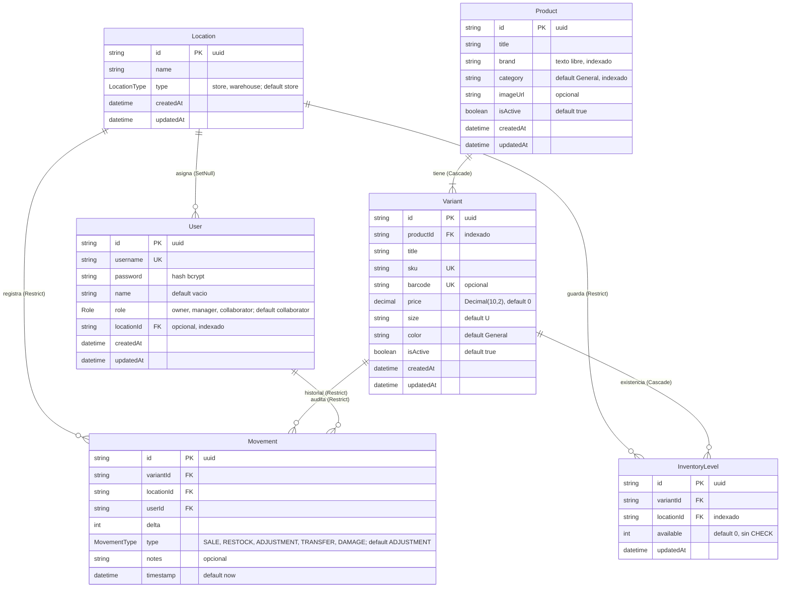
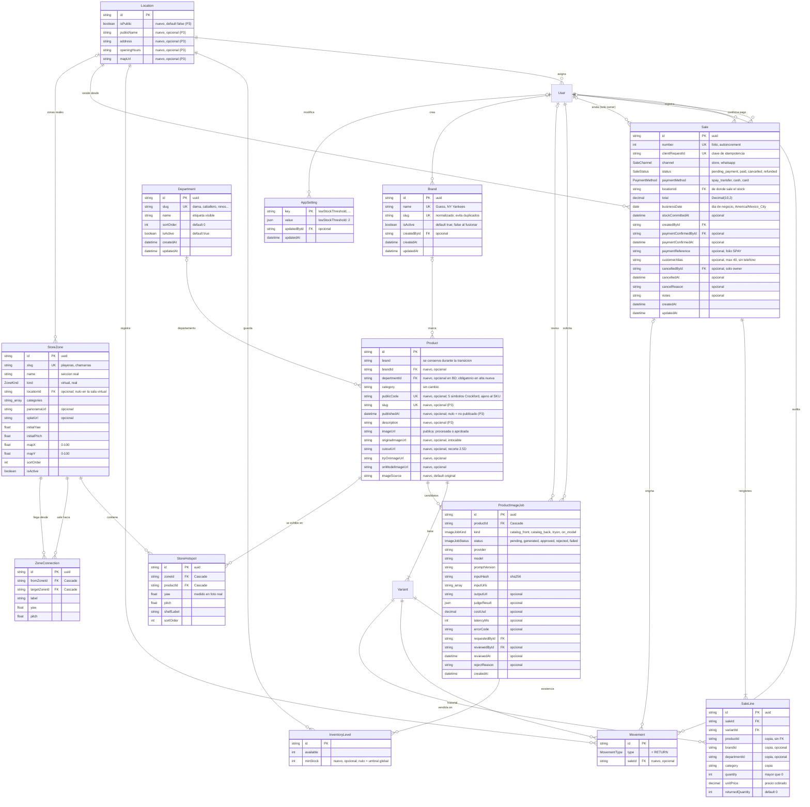
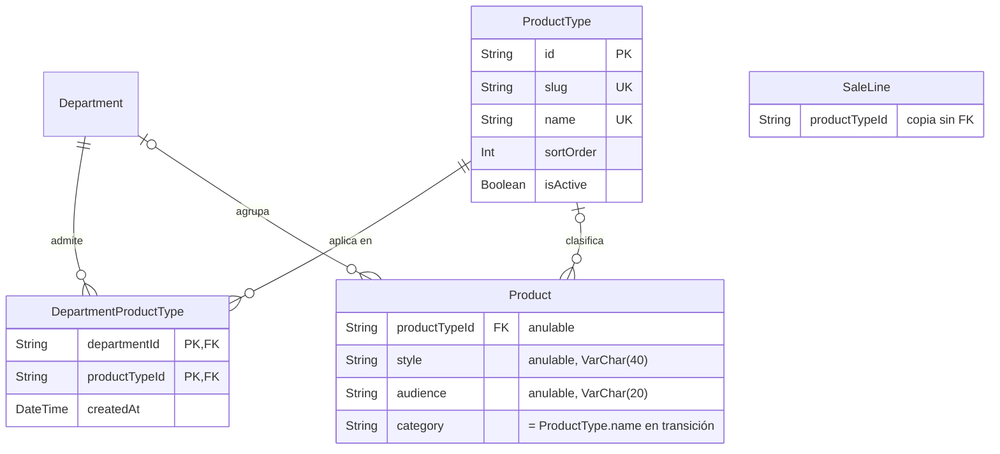

# LoloShop: modelo de datos y diagramas entidad-relación

- **Fecha:** 2026-11-05 · **Estado:** propuesta para revisión del dueño y del equipo de agentes · **Sin secretos** (repo público: solo nombres de variables, nunca valores)
- **Alcance:** solo documentación. No cambia `prisma/schema.prisma`, no crea migraciones y no toca la base de producción.
- **Convención:** **[V]** verificado leyendo el código o el esquema en el commit `bed06d2` + árbol de trabajo; **[P]** propuesta de este documento; **[D]** decisión del dueño, tomada (con fecha); **[A]** decisión del autor, revisable por el dueño; **[C]** dato de proveedor sin verificar.
- **Actualización 2026-11-05 (tarde):** incorpora las decisiones D1 a D7 del dueño y A1 a A7 del autor (registro en §8). Este documento es la **fuente de verdad del modelo**; el SRS, la arquitectura y la UX lo citan.
- **Fuentes leídas:** `CLAUDE.md`, `prisma/schema.prisma`, `lib/data/*`, `lib/domain/*`, `lib/actions.ts`, `lib/virtual-store/*`, `app/escanear/page.tsx`, `app/productos/page.tsx`, `app/api/whatsapp/webhook/route.ts`, y los specs `2026-10-27-loloshop-maestro-design.md` (§3 B5, §5.1), `2026-10-19-fotos-producto-ia-design.md` (§7, §14) y `2026-10-27-demo-tienda-digital-design.md`.

**Nombres fijos** (otros agentes los usan; no renombrar): `Sale`, `SaleLine`, `SaleChannel` (`store | whatsapp`), `PaymentMethod` (`spay_transfer | cash | card`), `SaleStatus` (`pending_payment | paid | cancelled | refunded`, sin más valores), `stockCommittedAt`, `paymentReference`, `customerAlias`, `clientRequestId`, `Brand`, `Department`, `AppSetting`, `ProductImageJob`, los campos de imagen `originalImageUrl`, `imageUrl`, `cutoutUrl`, `tryOnImageUrl`, `onModelImageUrl`, `imageSource`, y los campos públicos `Product.publicCode`, `Product.slug`, `Product.publishedAt`, `Product.description`.

---

## 1. Esquema actual [V]

Transcrito de `prisma/schema.prisma` (Prisma 5.22, PostgreSQL). No existe `prisma/migrations/` [V]: la base de producción se creó sin historial de migraciones.

Restricciones e índices [V]: `InventoryLevel @@unique([variantId, locationId])`; `Movement` tiene índices `(variantId, timestamp desc)`, `(locationId, timestamp desc)`, `(userId, timestamp desc)` y `(timestamp desc)`; `Product` indexa `category` y `brand`; `User` indexa `locationId`.

### 1.1 Lo que existe pero no se usa, y huecos de integridad [V]

| Hallazgo | Evidencia | Consecuencia |
|---|---|---|
| `MovementType` nunca se asigna: todos los movimientos quedan `ADJUSTMENT`. `SALE`, `RESTOCK`, `TRANSFER` y `DAMAGE` no se usan | `PrismaDataSource.adjustInventory` crea `Movement` sin `type` | No se pueden separar ventas de ajustes en el historial actual. Los datos viejos no sirven para reportes de ventas |
| `Movement.notes` nunca se escribe | Ninguna llamada pasa `notes` | Sin motivo de ajuste |
| El `Movement` solo se crea si hay `userId` | `if (userId)` en `adjustInventory` | Un ajuste sin usuario mueve stock sin auditoría (las actions siempre lo pasan, pero el contrato lo permite) |
| `available` puede quedar negativo | `upsert` con `increment: delta` sin condición; `create` con `available: delta` si no existe la fila | Una salida sobre una variante sin fila crea stock negativo |
| El alta fija stock en 1 y no crea `Movement` | `createProduct`: `available: 1`, sin movimiento | Stock inicial inventado y sin auditoría (D-1 del maestro) |
| El alta no recibe `category` | `CreateProductData` no tiene `category` | Todo queda `General`; los filtros de `/productos` (`Playeras`, `Pantalones`, `Hoodies`, `Tenis`, `Accesorios`, `Perfumes`, `Raquetas de Padel`) no encuentran nada |
| `Product.isActive` y `Variant.isActive` no se filtran | `getProducts()` sin `where` | Un producto desactivado sigue saliendo en `/catalogo` y en el bot |
| `Variant.title` copia el título del producto | `createProduct` | El comentario de dominio (`"M / Negro"`) no se cumple |
| `LocationType.warehouse` solo se puede crear; nada lo distingue en la UI ni en reglas | `createLocation` acepta `type` | Sin efecto hoy |
| `CLAUDE.md` dice "delta ±1", pero `/escanear` envía la cantidad tecleada | `app/escanear/page.tsx` (`delta = ±qty`) | El delta es cualquier entero distinto de cero; la documentación está desfasada |
| "Apartar" por WhatsApp no reserva nada en la base | `app/api/whatsapp/webhook/route.ts` solo lee stock y responde | La "reserva de 24 h" es un mensaje, no un dato |
| Borrar un producto con movimientos falla | `Variant → Product` es `Cascade`, pero `Movement → Variant` es `Restrict` | Correcto para auditoría; la baja debe ser `isActive = false`, no `DELETE` |

---

## 2. Esquema propuesto [P]

Todo lo nuevo es **aditivo**: tablas nuevas, columnas opcionales o con default, y un valor de enum nuevo. Nada existente cambia de tipo ni se borra en esta etapa (ver §5).

### 2.1 Diagrama completo

Las entidades existentes se muestran solo con los campos nuevos o relevantes; el resto sigue como en §1.

### 2.2 Ventas: `Sale` con renglones `SaleLine` [P]

**Decisión: cabecera + renglones.** Un cliente en caja o por WhatsApp suele llevar más de una prenda, y el pago (método, referencia SPAY, confirmación) es uno por ticket, no por prenda. Con una sola tabla habría que repetir el pago en cada fila o partir un cobro en varias "ventas", y los totales por ticket, el folio y la anulación serían frágiles. `SaleLine` cuesta una tabla y un `include`, y evita esos problemas.

| Campo | Por qué |
|---|---|
| `number Int @unique @default(autoincrement())` | Folio legible para el ticket y para conciliar con SPAY. El `id` sigue siendo uuid |
| `channel SaleChannel` | `store` (mostrador) o `whatsapp`. Enum: los dos canales son estables y su lista la define el negocio, no el dueño día a día |
| `paymentMethod PaymentMethod` | `spay_transfer`, `cash`, `card`. **Un método por venta**: el pago mixto queda fuera; si aparece, se agrega una tabla `SalePayment` sin romper `Sale` |
| `status SaleStatus` | `pending_payment` (WhatsApp entregado con `spay_transfer` aún sin confirmar), `paid`, `cancelled`, `refunded`. Describe el **pago**, no el stock. **No hay más estados**: no existen "entregada" ni "disputada"; una venta impagada se anula (§3.3) |
| `stockCommittedAt DateTime?` | Describe el **stock**: si tiene valor, el inventario ya se descontó. En el flujo decidido (§6, A1) toda venta nace con `stockCommittedAt = createdAt`; el campo se conserva para no cerrar la puerta a envíos pagados por adelantado |
| `clientRequestId String @unique` | Clave de idempotencia generada por el cliente (uuid) al abrir la pantalla de venta. Un doble toque o un reintento de red devuelve la venta ya creada en vez de crear otra (SRS RF-VEN-10) |
| `locationId` | Tienda de la que sale la mercancía, también en WhatsApp. Sin ella no se sabe qué `InventoryLevel` descontar |
| `total Decimal(10,2)` | Suma de `quantity × unitPrice`; se calcula en el servidor y se guarda para que el dashboard no recalcule |
| `businessDate @db.Date` | Día de negocio en `America/Mexico_City`, calculado en el servidor al crear. Permite `groupBy` de Prisma por día sin SQL crudo y sin errores de zona horaria (una venta a las 20:00 locales ya es otro día en UTC) |
| `createdById`, `paymentConfirmedById?`, `paymentConfirmedAt?`, `cancelledById?`, `cancelledAt?` | Auditoría por persona. Tres relaciones con `User`, con nombre de relación explícito. `createdById` puede ser owner, manager o collaborator (D1); `paymentConfirmedById` solo owner o manager (A2); `cancelledById` solo owner (D4) |
| `paymentReference?` | Folio o clave de rastreo de la transferencia SPAY. No es un secreto, pero tampoco se publica. La imagen del comprobante **no** se guarda |
| `customerAlias String? @db.VarChar(40)` | **[D] 2026-11-05 (D5):** no se guardan datos de contacto del cliente. Solo un alias corto y libre que escribe el personal para reconocer el pedido ("chamarra azul de la mañana"). El servidor rechaza un alias con 7 o más dígitos seguidos (evita teléfonos). Nunca va a proyecciones públicas, URLs ni logs. **No existen** `customerName` ni `customerPhone` |

`SaleLine.unitPrice` guarda el precio cobrado (puede diferir de `Variant.price` por descuento). `productId`, `brandId`, `departmentId` y `category` son **copias** al momento de la venta [P]: el reporte histórico no cambia si después se reclasifica el producto, y permiten `groupBy` de Prisma directo sobre `SaleLine` (Prisma no agrupa por campos de una relación). Son copias sin FK para no bloquear limpiezas de catálogo; `variantId` sí es FK con `Restrict`.

Restricciones [P]: `@@unique([saleId, variantId])` (una variante una vez por ticket; la cantidad va en `quantity`). `quantity > 0` y `returnedQuantity <= quantity` se validan en el servidor, porque Prisma no expresa `CHECK` en el esquema y agregarlo exigiría editar SQL de la migración (prohibido).

### 2.3 `Brand` y `Department` [P]

**`Brand` como tabla.** Hoy `Product.brand` es texto libre [V]; "Guess", "GUESS" y "guess " serían tres marcas en el dashboard. La tabla da un nombre canónico, un `slug` único y un lugar para logo o activo en el futuro. Durante la transición conviven `Product.brand` (texto) y `Product.brandId` (FK opcional); la columna de texto se retira en una migración posterior, aparte (§5).

**Alta de marcas [D] 2026-11-05 (D7).** Cualquier rol, incluido el `collaborator`, puede crear una marca nueva **durante el alta de producto**, directamente y sin aprobación. Reglas de servidor que lo hacen seguro:

- Antes de crear, se normaliza el nombre (recortar espacios, colapsar espacios internos) y se calcula el `slug` (minúsculas, sin acentos, solo `a-z0-9-`). Si el `slug` ya existe, se **reutiliza** la marca existente en vez de crear otra: "GUESS" y "guess " caen en `guess`.
- `Brand.createdById` registra quién la creó, para que el owner revise las nuevas.
- **Fusionar duplicados (solo owner):** en una transacción, reasigna `Product.brandId` y las copias `SaleLine.brandId` de la marca duplicada a la canónica, y deja la duplicada con `isActive = false` (no se borra, por auditoría). Así los reportes históricos por marca no quedan partidos. **Editar** (`name`) también es solo del owner; el `slug` no cambia al editar para no romper URLs.

**`Department` como tabla editable, no como enum [D] 2026-11-05 (D6).** Lista inicial: `dama`, `caballero`, `ninos`, `calzado`, `accesorios`. La lista **crecerá**: por eso es tabla y el owner agrega, renombra, ordena o desactiva sin migración. La ropa interior va **dentro de Dama** por ahora ([A] A4, revisable); si después se vuelve departamento propio, es una fila nueva y una reasignación, no una migración. Razones de la tabla:

- Un enum de Postgres exige migración y despliegue para cada cambio, y **quitar o renombrar un valor no es aditivo** (Postgres no borra valores de enum; Prisma recrea el tipo). Con la lista sin cerrar, eso es casi seguro.
- La tabla permite que el owner agregue, renombre (`name`), ordene (`sortOrder`) o desactive (`isActive`) sin desplegar. El `slug` queda estable para URLs y filtros.
- La carga inicial se hace con el seed o un script `tsx`, no con SQL.

Relación con `category` [V/P]: `category` (texto, sin cambio) es el **tipo de prenda** (`Playeras`, `Tenis`) y lo usan los filtros de `/productos` y `ZoneConfig.categories`. `Department` es el **público o la sección comercial**. Con D6, `calzado` y `accesorios` **son departamentos**; que además existan como categoría es aceptable (un tenis es `calzado` + `Tenis`). La relación fina categoría ↔ departamento sigue abierta (SRS D-CAT-2). Convertir `category` en tabla queda fuera de este documento. **Actualización 2026-11-10:** resuelto por §2.9 (`ProductType` global con la puente `DepartmentProductType`, tarea 3.8); `category` queda como texto de transición.

**Obligatoriedad de `departmentId` [A] (A3, revisable).** En la base es **opcional** para no romper los productos existentes (ninguno tiene departamento hoy). En la action de alta de productos **nuevos** es **obligatorio**: el servidor rechaza un alta sin departamento activo. El owner asigna el departamento a los existentes desde una edición rápida en `/productos` (selección múltiple + departamento). Hacerlo `NOT NULL` en la base es una migración posterior, aparte, cuando no quede ninguno sin asignar.

### 2.4 Imagen de producto y `ProductImageJob` [P, de `fotos-producto-ia` §7.1 y §14]

Campos nuevos en `Product`, todos opcionales o con default:

| Campo | Significado |
|---|---|
| `originalImageUrl` | Foto original del alta, intocable (JPEG 0.9 a 2048 px, §7.2). Ruta Blob `productos/original/…` |
| `imageUrl` (existe) | Imagen pública del catálogo: la original procesada o el candidato aprobado (maestra 1:1, 2048, fondo `#FFFFFF`, §14.1) |
| `cutoutUrl` | Prenda recortada para el riel 2.5D. La pide el contrato del recorrido (`PublicProduct.cutoutUrl`, maestro §5.1); no está en §7.1 del spec de fotos, se agrega aquí |
| `tryOnImageUrl` | Entrada lista para el probador (nombre compartido con los specs del probador) |
| `onModelImageUrl` | Salida 3 opcional |
| `imageSource String @default("original")` | `original` o `ai_approved`, para la leyenda pública (§9 del spec de fotos). Se respeta el tipo `String` del spec para no divergir; un enum sería más estricto, pero cambiarlo es decisión compartida |

Los derivados de §14.2 (200, 400, 600, 800, 1280 px) **no** van en columnas: se sirven con `next/image` o con un prefijo de Blob deducible de la maestra. Si el builder decide pregenerarlos, se agrega una tabla `ProductImageVariant` después. La foto trasera (D-10) se modela como `ProductImageJob.kind = catalog_back`; si el dueño la aprueba como foto pública, se agrega `backImageUrl` opcional.

`ProductImageJob` sigue §7.1 al pie de la letra: enums `ImageJobKind` (`catalog_front | catalog_back | tryon | on_model`) e `ImageJobStatus` (`pending | generated | approved | rejected | failed`), `productId` con `onDelete: Cascade`, dos relaciones con `User` (`requestedBy`, `reviewedBy`) e índices `@@index([status])`, `@@index([productId, kind])`, `@@index([createdAt])`. Se agrega `@@index([inputHash])` [P] para la caché de §7.3 (buscar un trabajo `generated`/`approved` con el mismo hash). El presupuesto mensual es `SUM(costUsd)` desde el inicio del mes, sin tabla extra.

### 2.5 Recorrido: `StoreZone`, `ZoneConnection`, `StoreHotspot` [P, del contrato del maestro §5.1]

El maestro admite BD o JSON versionado. **Decisión: BD**, porque el dueño cambiará fotos y hotspots sin redesplegar, y porque `productId` necesita integridad referencial (un hotspot que apunta a un producto borrado desaparece por `Cascade`). Un JSON versionado con la misma forma sirve para la sala virtual de pruebas mientras no exista la migración.

Los nombres de modelo siguen los tipos que ya existen en `lib/virtual-store/types.ts` [V] (`StoreZone`, `ZoneConnection`, `StoreHotspot`); el servidor los proyecta a las interfaces del contrato (`ZoneConfig`, `HotspotConfig`):

| Contrato (maestro §5.1) | Modelo |
|---|---|
| `ZoneConfig.id` | `StoreZone.slug` (el uuid queda interno) |
| `kind: "virtual" \| "real"` | enum `ZoneKind` |
| `categories: string[]` | `String[]` (array de Postgres), comparado con `Product.category` |
| `panoramaUrl`, `initialYaw`, `initialPitch` | iguales; `splatUrl` opcional queda para R-2 |
| `mapCoords: {x, y}` | `mapX`, `mapY` (Float, 0 a 100) |
| `connections[]` | filas de `ZoneConnection` (`fromZoneId`, `targetZoneId`, `label`, `yaw`, `pitch`) |
| `HotspotConfig` | `StoreHotspot` (`zoneId`, `productId` elegido, `yaw`, `pitch`, `shelfLabel`) |

`StoreZone.locationId` es opcional: nulo en la sala virtual, apunta a la tienda en las zonas reales (dos tiendas, dos recorridos). Índices: `StoreZone @@index([locationId, sortOrder])`, `StoreHotspot @@index([zoneId])`, `@@index([productId])`, `ZoneConnection @@unique([fromZoneId, targetZoneId])`.

Reglas que **no** son de la base sino de la proyección (deben tener test): un hotspot cuyo `productId` no está en la lista pública se oculta; al navegador no llegan SKU, `barcode`, `inventory`, `Movement`, `minStock`, `locationId` de bodegas ni datos de venta. La disponibilidad pública es `available | sold_out` calculada en el servidor (D-5). `publicCode` y `slug` **sí** son públicos (§2.7).

### 2.6 Otros cambios menores [P]

- `MovementType` gana `RETURN` (devoluciones y anulaciones con reingreso de stock). `SALE` empieza a usarse.
- `Movement.saleId String?` con FK a `Sale` (`Restrict`) e índice `@@index([saleId])`. Un movimiento de venta siempre sabe de qué ticket salió.
- `Movement @@index([type, timestamp(sort: Desc)])` para rotación y reportes por tipo.
- **Stock bajo [A] (A5, revisable):** umbral **global** configurable por el owner en `AppSetting` (`key = "lowStockThreshold"`, `value = 2` por defecto), con **override opcional** por variante y tienda en `InventoryLevel.minStock Int?` (nulo = usar el global; `0` = solo avisar de agotados). Índice `@@index([locationId, available])`.
- `AppSetting` (clave/valor, `key String @id`, `value Json`, `updatedById String?`, `updatedAt`): tabla mínima para ajustes del negocio que el owner cambia sin desplegar. Solo el owner escribe; el servidor valida el tipo por clave (`lowStockThreshold`: entero 0 a 99). No guarda secretos.

### 2.7 Campos públicos del catálogo [P] (A6, A7)

**Código público corto `Product.publicCode` [A] (A6, revisable).** `String? @unique`, 5 símbolos Crockford base32 (sin I, L, O, U), aleatorios y generados en el servidor con reintento ante colisión. **No se deriva del SKU** ni del `barcode` y no revela nada interno. Es por **producto**; la talla viaja como texto en el mensaje. Usos: el mensaje prellenado de WhatsApp ("Código K7Q2M") y la búsqueda del bot para "apartar"/consultar, que responde solo disponible/agotado por talla. Opcional en la base para los existentes; un script `tsx` lo rellena y el alta nuevo lo asigna siempre. Así se cierra B1 (quitar SKU e inventario exacto de lo público) sin romper el bot. El webhook lo trata como entrada no confiable (regex `^[0-9A-HJKMNP-TV-Z]{5}$` tras normalizar mayúsculas).

**Lo que la UX §9.3 necesita [A] (A7, revisable):**

| Necesidad de la UX | Decisión | Prioridad |
|---|---|---|
| `slug` de la ficha (`/catalogo/p/[slug]`) | `Product.slug String? @unique`, generado una sola vez de marca + título + `publicCode` (no se regenera si cambia el título, para no romper enlaces ya enviados por WhatsApp) | P3 |
| "Recién llegado" y bandera publicado/oculto | `Product.publishedAt DateTime?`: nulo = no publicado. Lo público lista `isActive && publishedAt != null && publishedAt <= now()` y con `imageUrl` | P3 |
| Descripción | `Product.description String?` (texto plano, sin HTML) | P3 |
| Disponibilidad pública por talla y por tienda | **No se guarda**: la proyección la calcula desde `InventoryLevel` como booleano (`available > 0` → "disponible"), solo para `Location.type = store` e `isPublic = true`. Nunca la cifra | P3 (B1 en P1 ya exige no exponer cifras) |
| Datos públicos de tienda (nombre, dirección, horario, mapa) | `Location.isPublic Boolean @default(false)`, `publicName`, `address`, `openingHours`, `mapUrl` (todos `String?`). El número de WhatsApp es uno del negocio y sigue en `NEXT_PUBLIC_WHATSAPP_NUMBER` | P3 |
| Departamento y marca canónica | `Department` y `Brand` (§2.3) | P1 |
| Medidas, cuidado y composición | **Fuera de P1** y sin columna por ahora; los acordeones no se pintan sin dato (UX §5.5) | Posterior |
| Tallas por departamento (CH–XG, numérico, edad) | **Fuera de P1**; `Variant.size` sigue como texto | Posterior |
| Foto de ambiente o trasera | **Fuera de P1**; `ProductImageJob.kind = catalog_back` y, si se aprueba, `backImageUrl` (§2.4) | P3, tras D-10 |

### 2.8 Control de inventario [P] (migración `inventory_controls`)

Migración **aditiva** (solo tablas nuevas y columnas anulables; sin `DROP`, `ALTER COLUMN`, `SET NOT NULL` ni `CHECK`). Sale con las migraciones de ventas en 3.7; antes solo se prueba en la rama de Neon `ventas-prueba`.

**`PriceChange`** (historial de cambios de precio): `id`, `variantId` → `Variant` (Restrict), `oldPrice` y `newPrice` `Decimal(10,2)`, `changedById` → `User` (Restrict), `reason String? @db.VarChar(120)`, `createdAt`. Índice `(variantId, createdAt DESC)`. Propósito: auditar quién cambió un precio, de cuánto a cuánto y por qué (motivo de 3 a 120 caracteres validado en el servidor, sin secuencias de 7 o más dígitos). Inversas: `Variant.priceChanges`, `User.priceChanges`.

**`Movement.requestId String? @unique`**: llave de idempotencia. Un reintento de la misma operación (mismo `requestId`) no duplica el movimiento ni el cambio de stock. Nulo en los movimientos existentes.

**`Product.mergedIntoId`, `mergedAt`, `mergedById`** (todos opcionales): unión de productos duplicados sin borrar historia. `mergedIntoId` es autorrelación `"ProductMerge"` (Restrict, índice propio; inversa `Product.mergedFrom`); `mergedById` → `User` (Restrict; inversa `User.productsMerged`). Un producto con `mergedIntoId` no nulo deja de listarse y queda como rastro. Las reglas de la unión (variantes, stock, ventas) viven en la capa de datos, no en la base.

### 2.9 Tipo de producto: `ProductType` y `DepartmentProductType` [P] (tarea 3.8, migración `add_product_types`)

> Detalle de diseño, reglas y lista inicial: `2026-11-10-taxonomia-productos-design.md`. Decisión del dueño del 2026-11-10 (opción B).

Migración **aditiva** (tablas nuevas, columnas anulables, índices y FK sobre columnas nuevas; sin `DROP`, `ALTER COLUMN`, `SET NOT NULL` ni `CHECK`). Sale a producción con la salida (3.7). El relleno es un script `tsx` idempotente (`prisma/scripts/backfill-product-types.ts`), nunca SQL.

| Tabla o columna | Tipo | Propósito |
|---|---|---|
| `ProductType` | tabla: `id` uuid, `slug` único y estable, `name` único (plural: "Playeras"), `sortOrder`, `isActive`, `createdAt`, `updatedAt` | **Tipo de prenda global** (Playeras, Pants, Tenis). Un tipo se repite entre departamentos sin duplicar filas, y "pants en total" se suma por `productTypeId`. Nunca se borra (`Restrict`); se desactiva |
| `DepartmentProductType` | tabla puente: PK compuesta (`departmentId`, `productTypeId`), ambas FK `Restrict`, `@@index([productTypeId])`, `createdAt` | Qué tipos aplican en cada departamento. El servidor exige el par en el alta, en la edición individual y en el tipo en lote |
| `Product.productTypeId` | `String?`, FK `Restrict`, `@@index([productTypeId])` | Tipo del producto. Anulable en la base (productos viejos); **obligatorio en el servidor** para altas nuevas. `NOT NULL` es una migración posterior, aparte |
| `Product.style` | `String? @db.VarChar(40)` | Atributo **estilo** (un slug, p. ej. `polo`), validado contra la lista del tipo en código. Opcional |
| `Product.audience` | `String? @db.VarChar(20)` | Atributo **"para"**: `dama`, `caballero` o `nino`. Solo en el departamento `calzado`, donde es obligatorio en altas nuevas. Texto validado, no enum (la lista puede crecer sin migración) |
| `SaleLine.productTypeId` | `String?`, **sin FK**, `@@index([productTypeId])` | Copia al vender, como `departmentId` (§2.2): el reporte histórico no cambia si se reclasifica o se une el producto |

Reglas:
- **Invariante de transición:** con `productTypeId` no nulo, `Product.category = ProductType.name`. Lo escribe siempre el servidor (alta, edición, lote, relleno); renombrar un tipo actualiza `Product.category` en la misma transacción. `SaleLine.category` nunca se reescribe. `category` se retira en una migración posterior, aparte, cuando nadie lo lea.
- El relleno mapea texto viejo a tipo (`Playeras`, `Pantalones`, `Hoodies`→Sudaderas, `Tenis`, `Perfumes`, `Raquetas de Padel`); `General`, `Accesorios` y cualquier otro valor quedan sin tipo ("Por revisar"). En `SaleLine` mapea desde su propia copia `category`, nunca desde el producto actual.
- Cambiar el departamento en lote no toca el tipo; un par que queda fuera de la puente se marca "Por revisar" en la aplicación, no en la base.
- Lo público (`PublicProduct`) no expone `productTypeId`, `style` ni `audience` en 3.8; `category` sigue siendo el texto público.
- Stock por tipo y tienda: `InventoryLevel` ⨝ `Variant` (activa) ⨝ `Product` (activo, sin unir) ⟕ `Department` ⟕ `ProductType`, agrupado por departamento, tipo, "para" y tienda (consulta en el addendum §12). Es interna.

---

## 3. Reglas de integridad [P]

### 3.1 Registrar una venta con descuento de stock

**Ventas concurrentes [D] 2026-11-05 (D1).** El colaborador de cada tienda **y** el owner registran ventas **al mismo tiempo y en las dos tiendas** (el manager también). El diseño lo soporta sin corromper stock por tres propiedades explícitas:

- **Sin lectura-y-luego-escritura:** el stock nunca se lee para decidir y después se escribe; el descuento es un único `UPDATE … WHERE available >= n` (paso 4). Dos ventas sobre la misma fila se serializan en el bloqueo de fila de Postgres y la segunda ve el valor ya descontado.
- **Orden fijo de bloqueos** por `variantId` (paso 2): sin interbloqueos entre tickets de varias líneas.
- **Filas independientes por tienda:** `InventoryLevel` es por `variantId × locationId`; ventas en tiendas distintas no compiten. Solo compiten dos personas vendiendo la misma variante en la misma tienda (p. ej. owner y colaborador en la tienda B), y ahí gana una y la otra recibe `InsufficientStockError`.

Una sola `prisma.$transaction` interactiva (nivel `ReadCommitted`, el default de Postgres):

1. **Validación previa, fuera de la transacción:** sesión con `requireSession()`; un `collaborator` solo vende desde su `locationId` (si no, error 403 con mensaje, no 500); owner y manager eligen la tienda de la venta (SRS RF-AUT-05); renglones con `quantity` entera > 0; variantes activas; `unitPrice >= 0`; `customerAlias` válido (§2.2). Si ya existe una `Sale` con el mismo `clientRequestId`, se devuelve esa y no se hace nada más.
2. **Ordenar los renglones por `variantId`.** Dos ventas simultáneas toman los bloqueos de fila en el mismo orden y no se bloquean entre sí (deadlock).
3. **Crear `Sale`** con `total` calculado en el servidor, `businessDate` en `America/Mexico_City`, `stockCommittedAt = now()` (toda venta descuenta al registrarse, §6) y `status = paid` si el método es `cash` o `card`, o `pending_payment` si es `spay_transfer` sin confirmar. La unicidad de `clientRequestId` protege también contra dos inserciones simultáneas del mismo reintento.
4. **Por cada renglón, descuento condicional:**
   `tx.inventoryLevel.updateMany({ where: { variantId, locationId, available: { gte: quantity } }, data: { available: { decrement: quantity } } })`.
   Es un solo `UPDATE … WHERE available >= n` atómico: si dos cajas venden la última pieza a la vez, una actualiza 1 fila y la otra 0.
5. **Si `count === 0`:** lanzar `InsufficientStockError` con la variante, el disponible y lo pedido. La transacción hace rollback completo: no queda `Sale` a medias ni stock descontado en otros renglones.
6. **Crear `SaleLine`** con las copias de §2.2 y **`Movement`** con `type: SALE`, `delta: -quantity`, `saleId`, `userId` del que registra.

Diferencia deliberada con `adjustInventory` [V]: la venta **no usa `upsert`**. Si no existe la fila de `InventoryLevel`, no hay stock que vender; crear la fila con negativo es justo el defecto de §1.1.

**Criterios de aceptación de concurrencia (test de integración contra una base Postgres real, no simulada):**

1. Stock 1 de una variante en la tienda A; dos `createSale` de 1 pieza lanzadas en paralelo (`Promise.all`) por usuarios distintos → exactamente una `Sale` creada, la otra `InsufficientStockError`; `available = 0`; un solo `Movement SALE`.
2. Stock 5 en A y 5 en B de la misma variante; 5 ventas de 1 pieza en paralelo en cada tienda → 10 ventas, `available = 0` en ambas, ninguna fila negativa.
3. Dos tickets de 2 líneas con las mismas variantes en orden inverso, en paralelo → ambos terminan (éxito o `InsufficientStockError`), sin deadlock ni timeout.
4. El mismo `clientRequestId` enviado dos veces en paralelo → una sola `Sale`.
5. Tras cada prueba: `available` final = inicial + Σ `Movement.delta` de la variante y tienda.

### 3.2 Stock insuficiente

- La venta se rechaza completa; el usuario ve qué renglón falló y cuánto hay.
- No hay "vender en negativo". Si la prenda está en la mano pero el sistema dice 0, primero se hace un ajuste auditado (`ADJUSTMENT` con `notes` obligatorio, solo owner o manager), y luego la venta. Así el descuadre queda registrado como ajuste y no se esconde dentro de una venta.
- No hay reservas: el chat de WhatsApp no aparta stock. Con el flujo decidido (§6) la venta de WhatsApp descuenta al registrarse en la entrega, así que nunca hay una venta pendiente sin stock comprometido. Una reserva real (tabla `Reservation` con caducidad) queda fuera de este documento.

### 3.3 Anulación y devolución

Las ventas y los movimientos **nunca se borran** (`Restrict` en todas las FK hacia `Sale` y `Movement`).

**Solo el owner anula ventas [D] 2026-11-05 (D4).** La action re-lee el usuario en BD (rol vigente) antes de anular. Las devoluciones también quedan en el owner por coherencia con D4 [A, revisable], mientras la política de devoluciones y cambios siga abierta (SRS D-VEN-3).

| Caso | Quién | Efecto en `Sale` | Efecto en stock |
|---|---|---|---|
| Anular una venta `pending_payment` cuya prenda **regresó** (el cliente no pagó y no se la llevó, o error de captura) | owner | `status = cancelled`, `cancelledById`, `cancelledAt`, `cancelReason` obligatorio | Por renglón, `increment` de `quantity - returnedQuantity` y `Movement` `RETURN` positivo con `saleId` |
| Anular una venta `pending_payment` cuya prenda **no regresó** (entregada y la transferencia nunca llegó) | owner | Igual, con `cancelReason` "impago" | **Sin reingreso**: la pieza ya no está en la tienda. La action exige que el owner responda "¿la prenda regresó?"; no hay valor por omisión |
| Anular una venta `paid` (error de captura) | owner | `status = cancelled` | Reingreso como en la primera fila |
| Devolución parcial | owner [A] | `SaleLine.returnedQuantity += n`; si todos los renglones quedan devueltos, `status = refunded` | `increment` de `n` y `Movement` `RETURN` `+n` con `saleId` |
| Devolución total | owner [A] | `status = refunded` | Reingreso de todo lo no devuelto |

Todo en una transacción, con la misma regla de orden por `variantId`. El reingreso va a la `locationId` de la venta; devolver en otra tienda sería un `TRANSFER` aparte. Los reportes de ventas excluyen `cancelled` y restan `returnedQuantity × unitPrice` de las ventas `paid` y `refunded`. Una venta impagada anulada sin reingreso aparece en el tablero del owner como pérdida (conteo e importe de `cancelled` con motivo "impago").

---

## 4. Consultas de los dashboards [P]

**Visibilidad [D] 2026-11-05 (D3).** Todos los roles ven importes. Owner y colaborador usan **el mismo dashboard**; el servidor fija el rango: el `collaborator` solo obtiene el **día de negocio en curso** (`businessDate = hoy` en `America/Mexico_City`) aunque pida otro rango, y solo de su `locationId` (SRS RF-AUT-03); el owner ve el histórico de las dos tiendas. El alcance histórico del `manager` no lo fijó el dueño: queda pendiente (SRS D-ROL-1, residual). El filtro de rango y de tienda se aplica en la action, nunca solo en la UI.

Todas corren en el servidor (actions con `requireSession()` y el filtro anterior). Las agrupaciones usan `groupBy` de Prisma gracias a `businessDate` y a las copias de `SaleLine`; donde haga falta SQL de lectura, se usa `$queryRaw` con plantilla parametrizada (es lectura, no migración, y nunca concatena texto).

"Venta válida" = `status in (paid, pending_payment)` (todas con `stockCommittedAt` no nulo, §6), o solo `paid` para dinero cobrado. El dashboard muestra las dos cifras: **vendido** (salió mercancía) y **cobrado** (pago confirmado), porque con WhatsApp pueden diferir.

| Tablero | Consulta | Índice que la sostiene |
|---|---|---|
| Ventas por día | `sale.groupBy({ by: ['businessDate'], where: { businessDate: rango, status: válidas }, _sum: { total }, _count })` | `Sale @@index([businessDate])` |
| Ventas por tienda | `groupBy` por `['locationId', 'businessDate']` | `Sale @@index([locationId, businessDate])` |
| Ventas por canal | `groupBy` por `['channel', 'businessDate']` | `Sale @@index([channel, businessDate])` |
| Ventas por método de pago | `groupBy` por `['paymentMethod']` en el rango | cubre `Sale @@index([businessDate])` (pocas filas por día) |
| Ventas por marca | `saleLine.groupBy({ by: ['brandId'], where: { sale: { businessDate: rango, status: válidas } }, _sum: { quantity } })`; el importe se calcula como `Σ quantity × unitPrice` (Prisma no suma productos de columnas: o se trae el renglón agregado por `brandId` con `$queryRaw`, o se agrega en TS) | `SaleLine @@index([brandId])`, `SaleLine @@index([saleId])` |
| Ventas por departamento | Igual, por `departmentId` | `SaleLine @@index([departmentId])` |
| Cobros pendientes (WhatsApp, tablero del owner; owner y manager confirman) | `sale.findMany({ where: { status: 'pending_payment' }, orderBy: { createdAt: 'asc' } })` con antigüedad visible | `Sale @@index([status, createdAt])` |
| Stock bajo (A5) | `inventoryLevel.findMany({ where: { OR: [ { minStock: null, available: { lte: global } }, { minStock: { not: null }, available: { lte: prisma.inventoryLevel.fields.minStock } } ] } })`, con `global` leído de `AppSetting.lowStockThreshold` (default 2). Referencia a columna disponible en Prisma 5 | `InventoryLevel @@index([locationId, available])` |
| Rotación (unidades vendidas por variante en 30 días) | `movement.groupBy({ by: ['variantId'], where: { type: 'SALE', timestamp: { gte: hace30 } }, _sum: { delta } })` y las devoluciones `RETURN` con `saleId` | `Movement @@index([type, timestamp desc])` |
| Sell-through | `vendidas / (vendidas + available actual)` por variante o por marca, combinando la consulta anterior con `InventoryLevel` | los dos anteriores |
| Días sin venta (stock muerto) | `movement.groupBy({ by: ['variantId'], where: { type: 'SALE' }, _max: { timestamp } })` contra variantes con `available > 0` | `Movement @@index([variantId, timestamp desc])` (existe [V]) |

Notas: los movimientos anteriores a esta migración son todos `ADJUSTMENT` [V], así que la rotación empieza a contar desde la primera venta registrada con `Sale`. Con el volumen de dos tiendas, estas consultas son baratas; los índices compuestos se justifican por el filtro de rango de fechas, no por volumen.

---

## 5. Estrategia de migración [P]

**Restricciones:** solo `prisma migrate`; nunca SQL escrito a mano ni `db push` en producción; todo se prueba antes en una **rama de Neon**; el respaldo existe antes del baseline (maestro B5).

**Calendario [D] 2026-11-05 (D2).** El módulo de ventas y los dashboards (migraciones 3 y 4 de §5.2 más su código) se despliegan **antes del Buen Fin**. El congelamiento aplica **durante** el Buen Fin y diciembre; no impide salir antes. Cada paso que toque producción (pasos 0, 5 y 6) cumple: **respaldo restaurable verificado ese mismo día** y ejecución **en horario sin ventas** (tiendas cerradas), con el retroceso escrito antes de empezar.

**Pendiente del dueño (abierto):** quién hace el respaldo, la rama de Neon y la configuración de `DIRECT_URL`. Sin responsable asignado, los pasos 0 a 2 no empiezan.

### 5.1 Orden de pasos

| Paso | Qué | Comando o acción | Criterio para seguir |
|---|---|---|---|
| 0 | **Respaldo restaurable** de producción | Volcado lógico con `pg_dump` guardado fuera del repo, además de la restauración a un punto en el tiempo de Neon [C: ventana según plan]. **Restaurarlo** en una rama o base vacía y contar filas por tabla | La restauración funciona y los conteos coinciden |
| 1 | Rama de Neon desde producción | Consola de Neon; su cadena de conexión va solo en el `.env` local | Rama creada |
| 2 | Variables para migrar [P] | Neon usa un *pooler* para la app; las migraciones necesitan conexión directa. Agregar `directUrl = env("DIRECT_URL")` al `datasource` y una base sombra (`SHADOW_DATABASE_URL`, otra rama vacía) para `migrate dev` | `npx prisma validate` pasa |
| 3 | **Baseline** en la rama | `npx prisma migrate diff --from-empty --to-schema-datamodel prisma/schema.prisma --script > prisma/migrations/0_init/migration.sql` (SQL **generado** por Prisma, no escrito a mano) y `npx prisma migrate resolve --applied 0_init` | Ver paso 4 |
| 4 | **Detección de drift** | `npx prisma migrate diff --from-url <rama> --to-schema-datamodel prisma/schema.prisma --exit-code` | Sale vacío. Si no, la base real difiere del esquema (residuos de `db push`) y se corrige el **esquema** primero |
| 5 | Baseline en producción | Mismo `migrate resolve --applied 0_init` contra producción (no ejecuta SQL, solo marca) | `npx prisma migrate status` dice "up to date" |
| 6 | Migraciones aditivas, cada una en su PR, probada en la rama y luego `npx prisma migrate deploy` en producción | ver §5.2 | Tests, `lint` y `build` en verde; `migrate status` limpio |

### 5.2 Migraciones aditivas, en orden

1. `add_product_image_fields`: `originalImageUrl`, `cutoutUrl`, `tryOnImageUrl`, `onModelImageUrl` (opcionales), `imageSource` (default `original`). Va primero porque desbloquea la Fase D1 (guardar el original).
2. `add_product_image_job`: enums `ImageJobKind`, `ImageJobStatus` y la tabla.
3. `add_brand_department`: tablas `Brand` (con `createdById`) y `Department`, `Product.brandId` y `Product.departmentId` opcionales con índice, y `Product.publicCode` opcional único (lo necesita B1 en P1). Después, **script `tsx` de relleno** (no SQL): crea una `Brand` por valor distinto normalizado de `Product.brand` y asigna `brandId`; carga los cinco departamentos de D6 (`dama`, `caballero`, `ninos`, `calzado`, `accesorios`); asigna `publicCode` a cada producto. Se corre primero en la rama.
4. `add_sales`: enums `SaleChannel`, `PaymentMethod`, `SaleStatus`; valor `RETURN` en `MovementType`; tablas `Sale` (con `clientRequestId` único y `customerAlias`, sin campos de contacto) y `SaleLine`; `Movement.saleId` opcional; `InventoryLevel.minStock Int?`; tabla `AppSetting`; índices de §4. El relleno crea `AppSetting.lowStockThreshold = 2`.
5. `add_store_zones`: enum `ZoneKind`, tablas `StoreZone`, `ZoneConnection`, `StoreHotspot`. Puede adelantarse si la Fase D2 lo necesita antes que las ventas; no depende de 3 ni de 4.
6. `add_public_catalog_fields` (P3, §2.7): `Product.slug`, `publishedAt`, `description`; `Location.isPublic`, `publicName`, `address`, `openingHours`, `mapUrl`. No bloquea ventas; va después del Buen Fin salvo que el dueño adelante P3.
7. `add_product_types` (tarea 3.8, §2.9): tablas `ProductType` y `DepartmentProductType`; `Product.productTypeId`, `style`, `audience` y `SaleLine.productTypeId` anulables con índice. Después, script `tsx` `backfill-product-types.ts` (idempotente). Va antes de la salida (3.7) y sale con ella.
8. **Más adelante, no aditiva, con su propia decisión:** hacer `Product.brandId` y `departmentId` obligatorios y retirar `Product.brand` (texto). Solo después de verificar el relleno y de actualizar `InventoryDataSource`, `PrismaDataSource`, `FixtureDataSource` y sus tests en el mismo PR.

**Dependencia abierta del dueño:** el alta por lote del worktree `feat/demo-alta-lote` (sin commitear) toca `createProductAction` y el alta; las migraciones 3 y 4 cambian ese mismo contrato. Conviene mergear primero ese worktree (tras `test`, `lint` y `build`) para no rehacer el alta dos veces.

Cada migración que cambie lo que lee o escribe la app va acompañada del cambio de contrato (`InventoryDataSource`, las dos implementaciones y sus tests) en el mismo PR, según la regla del equipo.

### 5.3 Riesgos

| Riesgo | Mitigación |
|---|---|
| **Drift** entre producción y `schema.prisma` (la base se creó sin migraciones, probablemente con `db push`) | Paso 4 en la rama antes de tocar producción. Si hay diferencias, ajustar el esquema, no la base |
| Baseline mal marcado: `migrate deploy` intentaría crear tablas que ya existen | `migrate resolve --applied` antes del primer `deploy`; probarlo en la rama completa |
| Conexión con *pooler* rompe `migrate` (locks de asesoría, sesiones) | `DIRECT_URL` solo para la CLI [P] |
| `ALTER TYPE … ADD VALUE` (`RETURN`): el valor nuevo no puede usarse dentro de la misma transacción que lo crea | Migración propia o al menos sin usar el valor en el mismo paso; Neon corre Postgres moderno [C: versión del proyecto] |
| El relleno de `Brand` agrupa mal variantes de escritura | Normalizar (recortar, minúsculas, sin acentos para el `slug`) y revisar la lista con el dueño antes de asignar |
| La app desplegada y el esquema se desfasan | Migraciones solo aditivas: el código viejo sigue funcionando con columnas nuevas opcionales. Desplegar la migración antes que el código que la usa |
| `CHECK (available >= 0)` no se puede declarar en Prisma sin editar SQL | Se garantiza en el servidor (descuento condicional de §3.1) y con tests. Si se quiere en la base, es una decisión aparte que hoy choca con la regla de no editar SQL |
| Cloudflare Workers: el cliente `wasm` no corre migraciones | Las migraciones se ejecutan con la CLI en Node (local o CI), nunca desde el Worker. `lib/platform/db.ts` no cambia por esto |
| Datos personales de clientes | No se guardan (D5). `customerAlias` se valida contra secuencias de dígitos; el seed y los fixtures usan alias ficticios; nunca en proyecciones públicas ni logs |
| Despliegue en temporada alta | Ventas y dashboards salen antes del Buen Fin (D2), con respaldo verificado y en horario sin ventas; durante el Buen Fin y diciembre solo correcciones urgentes |

---

## 6. Venta de WhatsApp: quién la registra y cuándo [A] (A1, A2, revisable)

El modelo separa **estado de pago** (`status`, `paymentConfirmedById`, `paymentConfirmedAt`) de **estado de stock** (`stockCommittedAt`). El flujo elegido es la antigua **opción A**:

| Paso | Quién | Efecto |
|---|---|---|
| 1. El cliente conversa por WhatsApp; el personal confirma disponibilidad | Personal | Nada en la base: **no hay reserva** |
| 2. **Entrega** (recoge en tienda o envío local) | Quien entrega: `collaborator` de esa tienda **u** `owner` (también `manager`) | Crea la `Sale`: `channel = whatsapp`, `locationId` = tienda de la que sale la prenda, `stockCommittedAt = createdAt` (el stock se descuenta **al registrar/entregar**), `customerAlias` opcional, `paymentReference` opcional |
| 2a. Si paga con `cash` o `card` al recoger | — | Nace `paid` |
| 2b. Si paga con `spay_transfer` | — | Nace `pending_payment` y aparece en el **tablero de cobros pendientes** del owner (§4) |
| 3. **Confirmar la transferencia SPAY** contra el banco | `owner` o `manager` (A2), con re-lectura del usuario en BD | `status = paid`, `paymentConfirmedById`, `paymentConfirmedAt`, `paymentReference` |
| 3'. La transferencia nunca llega | `owner` (D4) | Anula con motivo "impago" y elige si la prenda regresó (§3.3) |

Por qué A: el inventario refleja la realidad física al instante (no se vende dos veces una prenda que ya salió) y el riesgo de entregar sin cobro queda visible en un tablero, en vez de esconderse como stock fantasma. Mitigación del comprobante falso: el colaborador entrega con el comprobante a la vista, pero **no** puede marcar `paid` una transferencia; eso lo hace owner o manager contra el banco.

**Descartadas:** la opción B (el owner registra al confirmar el pago) y la variante B' (pendiente sin descontar stock). El esquema no les cierra la puerta (`stockCommittedAt` es nullable), pero ninguna action las habilita. Tampoco existen estados "entregada" ni "disputada": la entrega **es** el registro de la venta, y el impago se resuelve con anulación.

Reglas comunes: un colaborador solo crea ventas de su `locationId`; `cash` y `card` nacen `paid`; el bot de WhatsApp **no** crea ventas, sigue en solo lectura, y `BOT_API_KEY` no da permiso de escritura. El bot identifica la prenda por `publicCode` (§2.7), nunca por SKU.

---

## 7. Resumen de verificación

| Afirmación | Estado |
|---|---|
| Modelos, enums, relaciones, `onDelete` e índices de §1 | [V] `prisma/schema.prisma` |
| No existe `prisma/migrations/` | [V] |
| `MovementType` sin usar, `notes` sin usar, stock negativo posible, alta con `available: 1` y sin categoría | [V] `lib/data/prisma-source.ts`, `lib/data/source.ts` |
| Colaborador limitado a su tienda en `adjustInventoryAction`; solo owner crea tiendas | [V] `lib/actions.ts` |
| Tipos del recorrido `StoreZone`, `ZoneConnection`, `StoreHotspot` | [V] `lib/virtual-store/types.ts` (sin commitear) |
| Todo §2 a §6 | [P], salvo los campos de imagen y `ProductImageJob`, que vienen del spec de fotos §7.1; las reglas marcadas [D] y [A] vienen de §8 |
| Ausencia de `customerName` y `customerPhone` en todo el modelo | [I] este documento (D5) |

---

## 8. Registro de decisiones 2026-11-05

**Del dueño [D] 2026-11-05:**

| # | Decisión | Dónde aplica en este documento |
|---|---|---|
| D1 | Colaborador y owner registran ventas al mismo tiempo y en las dos tiendas; sin corromper stock | §3.1 (propiedades de concurrencia y criterios de aceptación) |
| D2 | Ventas y dashboards se despliegan **antes** del Buen Fin; el congelamiento aplica durante el Buen Fin y diciembre; paso a producción con respaldo restaurable y en horario sin ventas | §5 (calendario), §5.3 |
| D3 | Todos los roles ven importes; owner y colaborador ven el mismo dashboard; el colaborador solo el día en curso, el owner el histórico | §4 |
| D4 | Solo el owner anula ventas | §2.2, §3.3, §6 |
| D5 | No se guardan datos de contacto del cliente: fuera `customerName` y `customerPhone`; solo `customerAlias` opcional sin teléfono | §2.1, §2.2, §5.2, §5.3 |
| D6 | Departamentos: Dama, Caballero, Niños, Calzado, Accesorios; la lista crecerá: `Department` es tabla editable | §2.3, §5.2 |
| D7 | El colaborador crea marcas nuevas en el alta sin aprobación; el owner edita o fusiona duplicados | §2.1, §2.3 |

**Del autor (decisión del autor, revisable):**

| # | Decisión | Dónde aplica |
|---|---|---|
| A1 | WhatsApp: variante A. Quien entrega registra; stock al registrar/entregar; `pending_payment` hasta confirmar SPAY; tablero de cobros pendientes. `SaleStatus` = `pending_payment \| paid \| cancelled \| refunded` con `stockCommittedAt`; sin estados "entregada" ni "disputada" | §2.2, §3.2, §3.3, §6 |
| A2 | Confirmar pago SPAY: owner y manager | §2.2, §6 |
| A3 | Departamento obligatorio en el alta nueva; opcional en la base; el owner asigna los existentes por edición rápida | §2.3 |
| A4 | Ropa interior dentro de Dama por ahora | §2.3 |
| A5 | Stock bajo: umbral global configurable (default 2, `AppSetting`) con override `InventoryLevel.minStock` nullable | §2.6, §4 |
| A6 | Código público corto `Product.publicCode` (no el SKU) para el bot y el mensaje de WhatsApp; cierra B1 sin romper "apartar" | §2.7, §6 |
| A7 | Campos públicos de P3 (`slug`, `publishedAt`, `description`, datos públicos de `Location`); disponibilidad pública calculada, no guardada; medidas, cuidado, tallas por departamento y foto trasera fuera de P1 | §2.7, §5.2 |

**Siguen abiertos (pendientes del dueño):** merge del worktree `feat/demo-alta-lote` (de él dependen casi todos los RF-INV y RF-CAT del SRS); quién hace el respaldo y la rama de Neon y configura `DIRECT_URL` (§5). También: alcance histórico del dashboard para el `manager` (D3 no lo fija) y política de devoluciones (SRS D-VEN-3).
